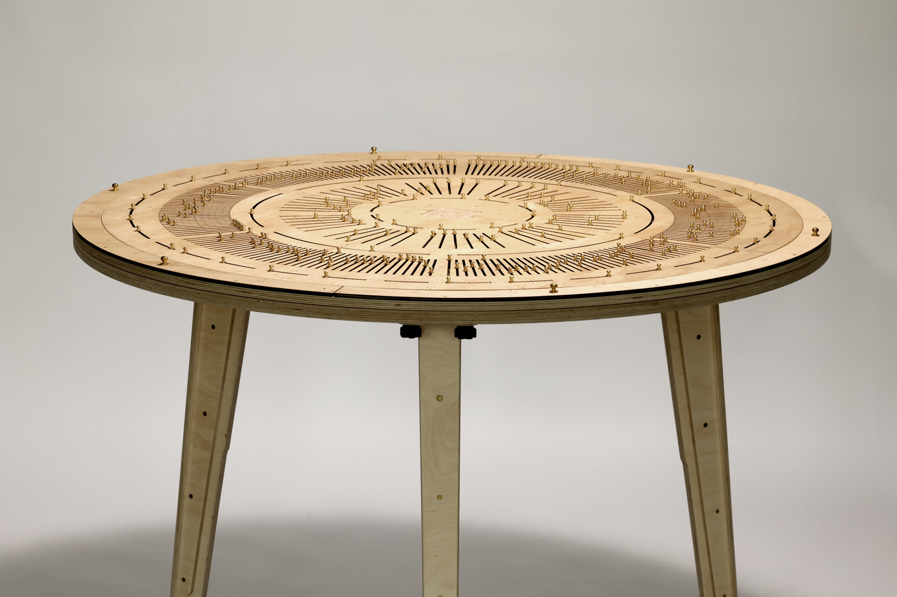
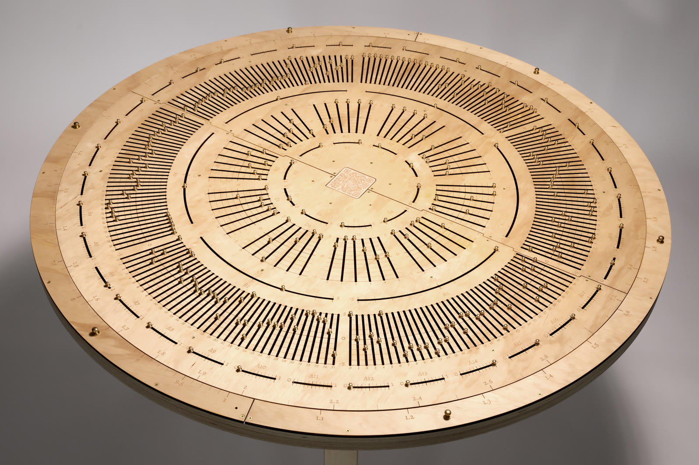
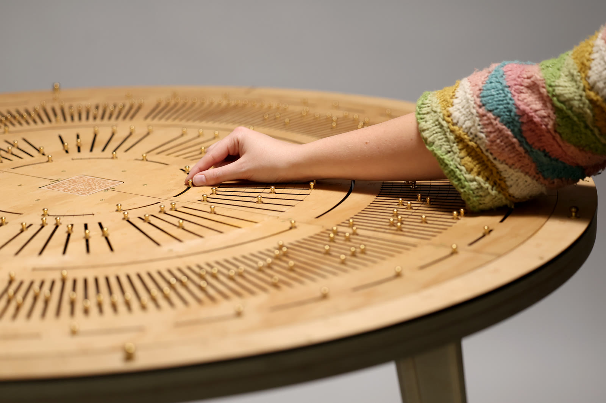

# Perceptron Apparatus

[](https://doi.org/10.5281/zenodo.20768557)

The Perceptron Apparatus is a 1.2 m plywood disc that runs a neural network by
hand. You set its sliders, turn its slide rule, and read off the answer: an
abacus for deep learning. This repository holds everything needed to make one
and to make it compute something: the fabrication files, the training code, the
trained weights, a digital twin for the browser, and the measurements behind the
design.

A [Cybernetic Studio](https://github.com/ANUcybernetics/) project by
[Ben Swift](https://benswift.me), with fabrication support from Sam Shellard at
UC's
[Workshop7](https://www.canberra.edu.au/future-students/study-at-uc/study-areas/design/workshop7).



| Top-down view of the computation rings                                                                                   | Setting values by hand                                                                             |
| ------------------------------------------------------------------------------------------------------------------------ | -------------------------------------------------------------------------------------------------- |
|  |  |

_Photographs by Andrew Meares. They show the first build, which has linear
weight scales; see [the weight scale](#the-weight-scale) for what changed._

## How it works

The apparatus is one fixed network: 36 inputs, 6 hidden units with ReLU
activation, and 10 outputs, with no biases anywhere. Every number in that
network has a slider, and the sliders sit in concentric rings, working inwards
from the rim:

| Ring | Holds                    | Sliders | Scale                |
| ---- | ------------------------ | ------- | -------------------- |
| log  | the slide rule           | none    | one decade, 1 to 10  |
| A    | inputs                   | 36      | 0 to 1               |
| B    | input-to-hidden weights  | 6 × 36  | log, 0 and 0.02 to 5 |
| C    | hidden values            | 6       | -5 to 5              |
| D    | hidden-to-output weights | 10 × 6  | log, 0 and 0.02 to 5 |
| E    | outputs                  | 10      | 0 to 5               |

Rings A, C and E hold values that are added up, and their sliders run around the
ring. Rings B and D hold the weights, in radial slots grouped by the unit they
feed. The log ring rotates, and with the fixed scale beside it forms a circular
[slide rule](https://en.wikipedia.org/wiki/Slide_rule).

To run the network:

1. Set each input slider A0 to A35.
2. For each hidden unit, take every input in turn. Multiply it by its weight in
   that unit's bank of ring B, using the slide rule, and add the product to the
   unit's slider on ring C.
3. Move any hidden slider that finished below zero back to zero. This is the
   ReLU.
4. Repeat step 2 with ring C as the inputs, ring D as the weights and ring E as
   the totals.
5. The output slider that has travelled furthest is the answer.

To multiply on the slide rule, align the first value on the outer scale with 1
on the inner scale. Find the second value on the inner scale and read the
product beside it on the outer scale.

A full pass is 276 multiplications: 216 for the hidden layer and 60 for the
output layer.

## The weight scale

The first build engraved every weight slot with a linear scale from -5 to 5.
Trained weights are not spread evenly over a range like that. In the weights
that build shipped with, 88% of the input-to-hidden weights were smaller than
0.5. They crowded into the middle tenth of each slot, where it is hard to tell
even 0.5 from 1.

Weight slots now carry a log scale. The outer end of the slot is zero, and after
a short gap the scale runs from 0.02 to 5 with labels at 1, 2 and 5 in each
decade. Equal distances are equal ratios, so a small weight is set as precisely
as a large one. Sign is not on the scale. A negative weight gets a different
marker, which the digital twin draws hollow, so the whole slot measures
magnitude.[^sign]

[^sign]:
    The physical marker for a negative weight is not designed yet. A second bead
    colour would do it.

There is a tidy rule behind this. A slider that holds a sum must be linear,
because addition is movement along it. A slider that only ever supplies a factor
can be logarithmic, and it then carries the same scale as the slide rule it is
read against.

`scripts/slider_scale_sim.py` measures what this buys. It sets every weight
slider with a random position error and counts how often the network still gets
the right answer. With the current MNIST weights, on the 10,000-image test set:

| Weight scale               | No error | 1% of slot | 2% of slot | 5% of slot |
| -------------------------- | -------- | ---------- | ---------- | ---------- |
| log, as engraved           | 67.4%    | 65.4%      | 61.2%      | 44.6%      |
| linear, -5 to 5            | 67.4%    | 54.9%      | 37.6%      | 18.2%      |
| linear, cut to fit weights | 67.4%    | 66.1%      | 63.6%      | 50.4%      |

On a 110 mm slot, 2% is about 2 mm. The last row is a linear scale that ends
exactly at the layer's largest weight. It does slightly better than the log
scale, but it would have to be engraved for one particular set of weights. The
largest weight in a layer varies from 0.8 to 4.3 across the three tasks here.
The log scale gets close to the fitted one with a single engraving for every
task.

## Training

The training code lives in `PerceptronApparatus.MLP` (Elixir, on Nx and EXLA)
and is mirrored without dependencies in `js/src/training/`. Four choices in it
exist only because the network will be worked by hand:

- **Cross-entropy loss.** The apparatus only needs the largest output to be the
  right one, and cross-entropy trains for that directly. Mean squared error asks
  for exact output values, and scored 19 points lower on MNIST.
- **Non-negative output weights.** With ring D never negative, every output
  slider only moves upwards as products are added, so ring E needs no negative
  half.
- **Weight noise.** Each training step multiplies every weight by a fresh random
  factor (log standard deviation 0.1). The network learns weights that still
  work when a slider is set slightly off.
- **Fitting to the sliders.** A bias-free ReLU network gives the same answers if
  one hidden unit's incoming weights are multiplied by _k_ and its outgoing
  weights divided by _k_. `fit_weights_to_apparatus/2` uses that freedom so that
  each hidden slider just reaches the end of its range while it accumulates and
  the largest output just reaches 5. Weights too small to set are zeroed.

`scripts/candidate_tasks.py` compares the recipes. Mean test accuracy at 6
hidden units over five seeds, with the same network at 64 hidden units for
scale:

| Recipe                         | MNIST | Zoo   | Letters | Dot-matrix |
| ------------------------------ | ----- | ----- | ------- | ---------- |
| mean squared error             | 50.5% | 83.4% | 54.4%   | 51.0%      |
| cross-entropy                  | 69.9% | 95.1% | 59.3%   | 99.9%      |
| + non-negative output weights  | 69.5% | 91.7% | 58.9%   | 99.9%      |
| + weight noise (as shipped)    | 68.0% | 93.3% | 57.8%   | 99.8%      |
| 64 hidden units, cross-entropy | 81.5% | 95.8% | 61.8%   | 99.9%      |

Together the last two steps cost one to two points of accuracy with perfect
sliders. Weight noise earns that back once the sliders are imperfect. At a 2%
slider error the best MNIST model scores 56.2% without weight noise and 62.5%
with it, and the letters model goes from 46.4% to 54.9%.

Train and export a task's weights with:

```bash
mix perceptron.export_weights --task mnist --output docs/mnist-weights.json
mix perceptron.export_weights --task zoo --output docs/zoo-weights.json
mix perceptron.export_weights --task letters --output docs/letters-weights.json
```

Each file holds the weight matrices `B` (36 × 6) and `D` (6 × 10), padded with
zeros where a task uses fewer inputs or outputs, and the test accuracy of the
weights as written. `mix help perceptron.export_weights` lists the options.

## Tasks

Three tasks ship with trained weights.

### Handwritten digits

MNIST digits are cut down from 28 × 28 pixels to 6 × 6 by keeping every fifth
pixel or so, which gives the 36 inputs. The ten outputs are the digits. The
exported weights score 67.4% on the MNIST test set, against 10% for guessing.
With 64 hidden units the same 6 × 6 images reach 81.5%, so the rest of the gap
to a real digit classifier is the image size.

### Animals

The [UCI Zoo dataset](https://archive.ics.uci.edu/dataset/111/zoo) describes 101
animals by 15 yes-or-no traits (hair, feathers, lays eggs, and so on) and a leg
count. That makes 21 inputs, 15 for the traits and 6 for a one-hot leg count,
and 7 outputs: mammal, bird, reptile, fish, amphibian, insect and invertebrate.
The exported weights get all 20 held-out animals right, and all 101 overall.
Averaged over repeated cross-validation the recipe scores 93%.

This is the task to show a visitor. The inputs are things they know about an
animal of their own choosing, and some of the weights can be read. The largest
weight from "feathers" feeds a hidden unit whose strongest output is "bird".

### Next letter

This one is a language model. The alphabet is the nine letters `etaoinshr` and
the space. The network sees the previous three symbols, one-hot (30 inputs), and
scores each of the ten symbols as the next one. Its text is
[_Alice's Adventures in Wonderland_](https://www.gutenberg.org/ebooks/11) and
[_Pride and Prejudice_](https://www.gutenberg.org/ebooks/1342), reduced to the
words that can be spelt with those nine letters.

The exported weights pick the right next symbol 57.3% of the time on held-out
text. A lookup table of every three-symbol context manages 62.2%, so there is
little left to learn at this context length. Feed each prediction back in as the
newest symbol and the apparatus writes `the the the the`, for as long as anyone
is willing to keep going. Choosing among the leading outputs by chance breaks
the loop, at some cost to the spelling.

### Tasks that did not fit

- **Poker hands** shipped with the first build. Its weights turned out to
  predict "nothing in hand" for 9,996 of 10,000 test hands.
- **Dot-matrix digits** (5 × 7 pixels with three flipped) work almost perfectly
  under cross-entropy, but show nothing that MNIST does not.
- **Language identification** from letter frequencies reaches only 54% on
  six-word phrases across ten languages, and 26% on single words.

## Making one

The fabrication files are SVGs for CNC routing and laser cutting, generated by
the Elixir application from Ash resources.

```bash
mix perceptron                      # 1200 mm board, 36-6-10 network, to svg/board.svg
mix perceptron --size 1150 --file svg/small.svg
mix perceptron --qr "https://example.com"
mix perceptron.generate --preset xor
mix help perceptron                 # all options
```

A board need not be 36-6-10. The ring layout follows whatever network shape it
is given:

```elixir
board = PerceptronApparatus.create_board!(1200.0, 25, 5, 10)
svg = PerceptronApparatus.Board.render(board)
```

The SVG marks each path with the cut it needs. On the top plate, `top full` is a
full-depth cut, `top slider` a full-depth routed channel, `top etch` a light
v-cut and `top etch heavy` a heavier one. On the bottom plate, `bottom slider`
is a partial-depth channel that holds the slider bases captive, and
`bottom rotating` is the void for the rotating log ring.

`docs/` has Typst sources for a poster and an instruction sheet. The poster
reads a weights file directly, so it follows the weights when a task is
retrained.

## Digital twin

`js/` is a TypeScript package, `perceptron-apparatus`, that draws the apparatus
in the browser and animates it.

```ts
import { PerceptronApparatus } from "perceptron-apparatus";
import {
  ComputationAnimator,
  ZooInputWidget,
  ZOO_CLASS_NAMES,
  zooWeights,
} from "perceptron-apparatus/widgets";

const apparatus = new PerceptronApparatus(container, {
  nInput: 36,
  nHidden: 6,
  nOutput: 10,
});
const input = new ZooInputWidget(controls);
const animator = new ComputationAnimator(apparatus, zooWeights);

const { prediction } = await animator.compute(input.getValues(), {
  mode: "step",
});
console.log(ZOO_CLASS_NAMES[prediction]);
```

In step mode the animator performs every multiplication in order, turning the
log ring and moving the sliders as a person would. The package has three entry
points:

- `perceptron-apparatus`: SVG generation and the slider and log ring animation
  API
- `perceptron-apparatus/widgets`: the animator, input widgets for the three
  tasks (`MnistInputWidget`, `ZooInputWidget`, `LettersInputWidget`) and their
  bundled weights
- `perceptron-apparatus/training`: `trainMnist()`, the training recipe above
  with no dependencies

The built package is committed in `js/dist/`, so it installs straight from
GitHub with pnpm or yarn:
`pnpm add github:benswift/perceptron_apparatus?path=js`.

## Background

A perceptron with adjustable physical weights is an old idea.
[Frank Rosenblatt's Mark I Perceptron](https://en.wikipedia.org/wiki/Perceptron)
stored its weights in motor-driven potentiometers. Networks have since grown by
many orders of magnitude, but each step a large model takes is still a
multiplication and an addition. This apparatus makes a person do 276 of them.

Other people have taken the "by hand" route with different materials.
[Tom Yeh's AI by Hand series](https://www.bu.edu/csmet/?p=29417) works networks
on paper, and
[Ishan Anand put GPT-2 in a spreadsheet](https://tomshardware.com/tech-industry/artificial-intelligence/chatgpts-ancestor-gpt-2-jammed-into-125gb-excel-sheet-llm-runs-inside-a-spreadsheet-that-you-can-download-from-github).
At the other end, there are
[designs for analog chips that compute attention with charge-based memory cells](https://arxiv.org/abs/2409.19315v1).
We have not found another hand-operated device for a trained network.

The next question is the rest of a transformer block. Attention needs three
operations beyond the ones here. The query-key score multiplies two slider
readings, which a slide rule does as readily as it multiplies by a weight.
Softmax needs an exponential, and a number set as an angle on the log ring is
already read as its exponential. The weighted mix of values is more
multiply-and-add. A four-token, single-head version looks feasible. Nobody has
built one.

## Working on the code

The project uses [mise](https://mise.jdx.dev/) to manage Elixir, Erlang, Node
and pnpm.

```bash
mise install                # runtimes
mix deps.get                # Elixir dependencies
cd js && pnpm install       # TypeScript dependencies

mise run test               # all tests, Elixir and TypeScript
mise run build              # compile, and rebuild js/dist
mise run lint               # lint the TypeScript package
mise run check              # type-check the TypeScript package
```

The analysis scripts are standalone: `uv run scripts/slider_scale_sim.py` and
`uv run scripts/candidate_tasks.py`. [`CHANGELOG.md`](CHANGELOG.md) records
design changes, and the `linear-weight-scale` tag is the last commit of the
first design.

## Citation

If you use the Perceptron Apparatus, please cite it. Machine-readable citation
metadata lives in [`CITATION.cff`](CITATION.cff); GitHub's "Cite this
repository" button turns it into APA or BibTeX.

## Author

(c) 2024 Ben Swift, with fabrication support from Sam Shellard
([Workshop7](https://www.canberra.edu.au/future-students/study-at-uc/study-areas/design/workshop7),
University of Canberra).

The Zoo dataset (Richard Forsyth, 1990) is redistributed in `priv/zoo.data` from
the UCI Machine Learning Repository under CC BY 4.0.

## Licence

This project is dual-licensed:

- code (Elixir, TypeScript, and build tooling) under the
  [MIT licence](LICENSE-MIT)
- documentation, fabrication designs, and educational materials (`docs/`,
  generated SVGs, posters, and worksheets) under
  [Creative Commons Attribution 4.0 International](LICENSE-CC-BY-4.0)
  (CC-BY-4.0)
